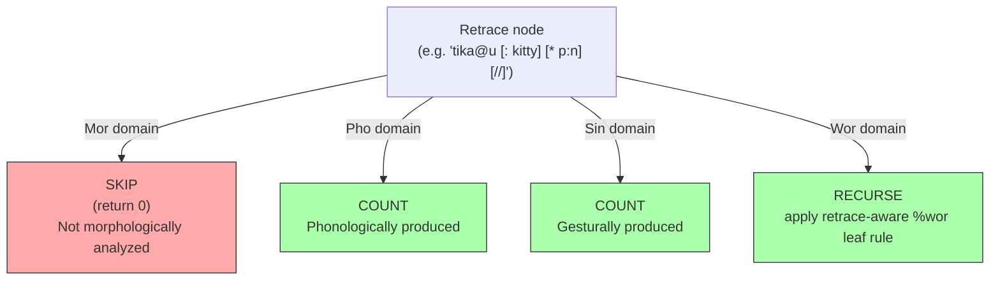

# Retraces and Repetitions

**Status:** Current
**Last updated:** 2026-05-11 23:16 EDT

Retraces mark content that the speaker said but then corrected, repeated,
or abandoned. They are one of the most consequential constructs in CHAT
because they affect how every dependent tier aligns to the main tier.

## CHAT Syntax

A retrace has two parts: the **retraced content** (what the speaker said
first) and the **correction** (what follows). The retraced content is
marked with a trailing bracket code:

| Marker | Name | Meaning |
|--------|------|---------|
| `[/]` | Partial repetition | Speaker repeats the same words |
| `[//]` | Full correction | Speaker restarts with different words |
| `[///]` | Multiple correction | Multiple false starts |
| `[/-]` | Reformulation | Speaker rephrases with different structure |

### Single-Word Retraces

When only one word is retraced, no angle brackets are needed:

```chat
*CHI: I [/] I want that .
*CHI: ana [//] an .
*MOT: the book [/-] the magazine is here .
```

### Group Retraces

When multiple words are retraced, angle brackets delimit the scope:

```chat
*MOT: <the dog> [//] the cat ran .
*CHI: <I want> [/] I need cookie .
*CHI: <I want the> [///] give me that .
```

### Retraces with Replacements

A retraced word often has a replacement `[: target]` and/or error code
`[* code]`. This is common in aphasia and child language corpora where
the speaker produces an incorrect form:

```chat
*PAR: tika@u [: kitty] [* p:n] [//] kitty is nice .
%mor: noun|kitty aux|be-Fin-Ind-Pres-S3 adj|nice-S1 .

*PAR: lɛɾɪ@u [: later] [* p:n] [//] later in the day .
%mor: adv|late adp|in det|the-Def-Art noun|day .

*CHI: male [: female] [* s:r] [/] male [: female] [* s:r] .
%mor: adj|female-S1 .
```

In each case, the retraced word (before the `[//]` or `[/]`) is excluded
from %mor alignment. Only the correction (after the marker) is counted.

## Alignment Behavior

Retraces interact differently with each dependent tier domain:



**Why %mor skips retraces:** The %mor tier represents the morphological
analysis of what the speaker *meant* to say. Retraced content is a false
start or error — it was produced phonologically but is not part of the
intended linguistic structure. The correction after the retrace marker
carries the morphological analysis.

**Why %pho/%sin/%wor include retraces:** These tiers document what was
*actually produced* — the sounds, gestures, and timing of the speech as
it happened, including false starts. The retrace was physically spoken,
so it appears in these tiers.

For `%wor`, retrace ancestry does **not** change leaf-level membership:

- spoken word tokens count both inside and outside retrace
- that includes fillers, fragments, nonwords, and untranscribed placeholders
- overlap annotations do not affect `%wor` membership

Exact corpus-shaped contrast:

```chat
*CHI:	<one &+ss> [/] one play ground .
%wor:	one •321008_321148• ss •321148_321368• one •321809_321969• play •322049_322310• ground •322390_322890• .

*CHI:	&+ih <the what> [/] what's letter &+th is this ?
%wor:	ih •49063_49103• the •49103_49163• what •49183_50205• what's •50205_50405• letter •50405_50685• th •50886_50946• is •50946_51046• this •51086_51586• ?
```

## Implementation and related guidance

Parser representation and validation belong to [Chatter](../related-tools.md#chatter-and-chat-format-tools).
For Batchalign's treatment of ASR output, see
[Retrace detection](../batchalign/reference/retrace-detection.md).
