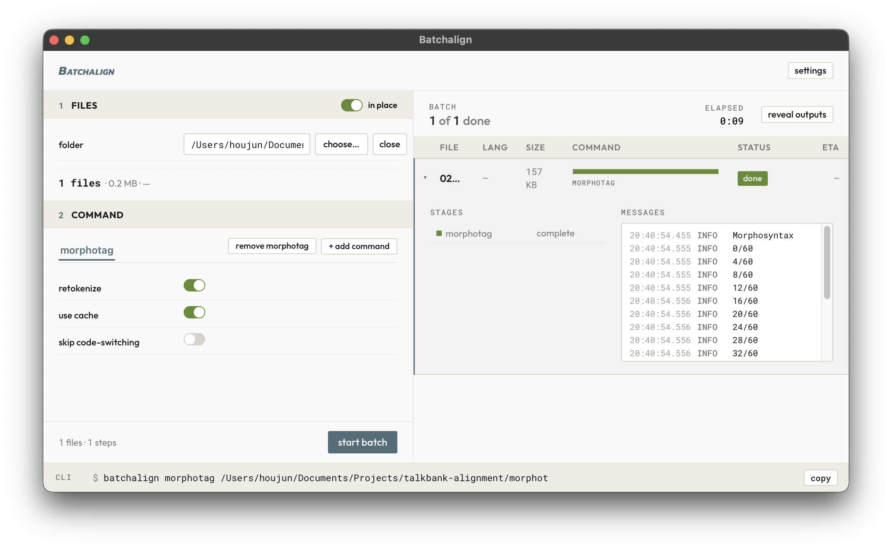
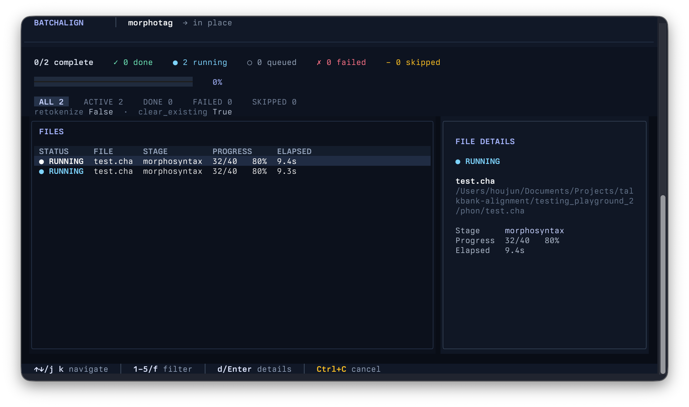

# Batchalign

Welcome to Batchalign. Batchalign is a audio and ML pipeline for producing and enriching CHAT transcripts. It supports transcription, forced alignment, morphotagging, utterance segmentation, translation, diarization, comparison, and the Batchalign desktop shell.

Batchalign is available in two variants: as an application or as an a command-line tool. Downloads for both versions follows:

## GUI Application


Press the blue rectangle corresponding to the operating system which you use to download the Batchalign application:

<div class="platform-downloads">
  <div class="platform-option">
    <a class="platform-download" id="download-macos" href="https://github.com/TalkBank/batchalign/releases">
      <i class="fa-brands fa-apple" aria-hidden="true"></i>
      <strong>macOS</strong>
      <small id="version-macos">All releases</small>
    </a>
    <p class="download-options" id="detail-macos">DMG</p>
  </div>
  <div class="platform-option">
    <a class="platform-download" id="download-windows" href="https://github.com/TalkBank/batchalign/releases">
      <i class="fa-brands fa-windows" aria-hidden="true"></i>
      <strong>Windows</strong>
      <small id="version-windows">All releases</small>
    </a>
    <p class="download-options">x86-64</p>
  </div>
  <div class="platform-option">
    <a class="platform-download" id="download-linux" href="https://github.com/TalkBank/batchalign/releases">
      <i class="fa-brands fa-linux" aria-hidden="true"></i>
      <strong>Linux</strong>
      <small id="version-linux">All releases</small>
    </a>
    <p class="download-options">x86-64<span hidden> · <a id="download-deb" href="https://github.com/TalkBank/batchalign/releases">DEB</a></span><span hidden> · <a id="download-rpm" href="https://github.com/TalkBank/batchalign/releases">RPM</a></span></p>
  </div>
</div>

<p id="download-status" aria-live="polite">Finding the latest installers…</p>

[All releases and other builds](https://github.com/TalkBank/batchalign/releases)

<script src="downloads.js" defer></script>

## Terminal Interface (Advanced)


For the advanced terminal interface, the following scripts allows you to install Batchalign via `uv`.

On macOS or Linux:

```bash
curl -LsSf https://raw.githubusercontent.com/TalkBank/batchalign/main/bootstrap/bootstrap.sh | sh
```

On Windows, from PowerShell:

```powershell
powershell -NoProfile -ExecutionPolicy Bypass -Command "Invoke-Expression ((Invoke-WebRequest -UseBasicParsing 'https://raw.githubusercontent.com/TalkBank/batchalign/main/bootstrap/bootstrap.ps1').Content)"
```
